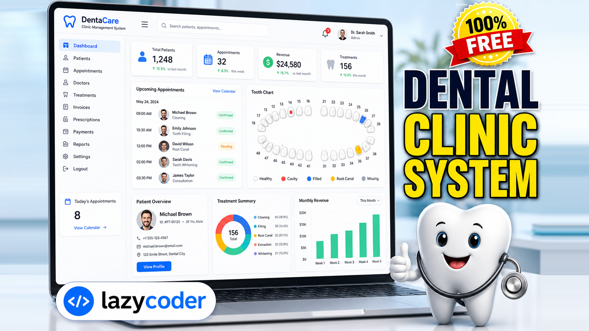

# Dental Clinic Management System



A comprehensive, production-quality **Dental Clinic Management System** built with **Django**. It digitises the complete workflow of a modern dental practice — appointments, an interactive 32‑tooth chart, treatments, digital prescriptions, invoicing & payments, inventory, reviews and rich analytics — across four uniquely themed, **role-based dashboards** (Administrator, Dentist, Receptionist, Patient).

It includes local rule-based symptom, cost, and no-show tools, plus a local FAQ chatbot. DentaBot uses programmed replies and does not require an external AI API or API key.

> Built for the **lazycoder** YouTube channel as a full, end-to-end reference project.

---

## Table of Contents

- [Features](#features)
- [Tech Stack](#tech-stack)
- [Screenshots & Diagrams](#screenshots--diagrams)
- [Getting Started](#getting-started)
- [Demo Login Accounts](#demo-login-accounts)
- [Key URLs](#key-urls)
- [Project Structure](#project-structure)
- [System Documentation](#system-documentation)
- [Project Report](#project-report)
- [License](#license)

---

## Features

- **Role-based dashboards** — a distinct theme, layout and permission set for Admin, Dentist, Receptionist and Patient.
- **Appointment management** — booking, status tracking (Pending / Confirmed / Completed / Cancelled / No‑Show) and AI no‑show risk.
- **Interactive tooth chart** — a 32‑tooth (universal numbering) chart with six condition types per patient.
- **Clinical records** — treatments linked to patient, service, tooth and cost.
- **Digital prescriptions** — multi-item prescriptions with a printable view.
- **Billing** — invoices with line items, tax, discount, partial payments and automatic balance calculation.
- **Inventory** — stock tracking with low-stock alerts.
- **Reviews** — patient feedback shown on the public website.
- **Assistant tools** — local rule-based symptom checker, cost estimator, no-show risk helper, and DentaBot FAQ chatbot; no external AI key is required.
- **Analytics** — revenue, appointment and patient-growth charts powered by Chart.js.
- **Custom admin panel** — a bespoke management console (the default Django admin is intentionally not used) with full CRUD.
- **Public marketing website** — home, services (with pricing), about and contact pages.
- **Patient identity verification** — local government-ID OCR followed by guided face capture and local face-to-ID comparison.
- **Administrator activity logs** — administrator-only searchable sign-in and selected account, appointment, resource, and billing event history.
- **Responsive & accessible** — works beautifully on desktop, tablet and mobile.
- **Privacy-safe demo data** — seeded data uses `example.com` emails and placeholder phone numbers only.

---

## Tech Stack

| Layer        | Technology                        |
| ------------ | --------------------------------- |
| Language     | Python 3.10+                      |
| Framework    | Django 5.2+ (Model‑View‑Template)  |
| Database     | MySQL 8.0+                        |
| Styling      | Bootstrap 5 + custom CSS theming  |
| Icons        | Bootstrap Icons                   |
| Charts       | Chart.js                          |
| Images       | Pillow                            |
| Fonts        | Google Fonts (Inter)             |

---

## Screenshots & Diagrams

All system diagrams (architecture, use‑case, ER, DFD levels 0 & 1, class, sequence, activity and module hierarchy) are included in [`report/diagrams/`](report/diagrams) and embedded in the full project report.

---

## Getting Started

### Prerequisites

- **Python 3.10 or newer** — check with `python --version`
- **pip** (bundled with Python)
- **Git** (to clone the repository)
- **MySQL 8.0 or newer** — running locally or reachable from this machine

### 1. Clone the repository

```bash
git clone https://github.com/sumitkumar1503/Dental-Clinic-Management-System.git
cd Dental-Clinic-Management-System
```

### 2. Create and activate a virtual environment

**Windows (PowerShell):**

```powershell
python -m venv venv
.\venv\Scripts\Activate.ps1
```

> If activation is blocked, run PowerShell once as admin: `Set-ExecutionPolicy -Scope CurrentUser RemoteSigned`

**macOS / Linux:**

```bash
python3 -m venv venv
source venv/bin/activate
```

### 3. Install dependencies

```bash
pip install -r requirements.txt
```

### 4. Configure MySQL

Create a database and a dedicated application user in MySQL (substitute a strong password):

```sql
CREATE DATABASE aimsmile CHARACTER SET utf8mb4 COLLATE utf8mb4_unicode_ci;
CREATE USER 'aimsmile_user'@'localhost' IDENTIFIED BY 'replace-with-a-strong-database-password';
GRANT ALL PRIVILEGES ON aimsmile.* TO 'aimsmile_user'@'localhost';
```

Copy the environment template and set the matching MySQL credentials before running migrations:

```powershell
Copy-Item .env.example .env
notepad .env
```

Set `DB_NAME`, `DB_USER`, `DB_PASSWORD`, `DB_HOST`, and `DB_PORT` in `.env`. Keep `.env` private and do not commit it.
The local DentaBot works without an API key or external AI service. Its answers are based on programmed rules and are intentionally limited.

### 5. Apply database migrations

```bash
python manage.py migrate
```

### 6. Seed privacy-safe demo data (recommended)

This creates demo users, services, appointments, invoices and 12 months of data so the charts look great immediately.

```bash
python manage.py seed_demo
```

### Administrator-created accounts

When an administrator creates a user, they set its initial password in the management panel. Share the login details with the user through a secure channel; the system does not send account emails.

### 7. Run the development server

```bash
python manage.py runserver
```

### Patient identity verification

Patient sign-up now follows ID upload and OCR → guided face capture → local face
match → review of extracted personal details → final registration. The scanner
automatically detects Philippine National ID, Driver's License, Passport, or
UMID when its text is recognizable; users can select the type manually if
detection is uncertain. After face verification, the extracted name, birth date,
and address prefill the registration form for review and correction.

The OCR and face matching run locally; original ID photos and face captures are
not retained by the application (Django may temporarily buffer uploads during
a request). With separate, required consent, the application stores a keyed
digest of the normalized ID number and a Fernet-encrypted face template for
duplicate checks. It does not store the ID number in readable form. Exact ID
matches are blocked; possible face-only matches are sent to clinic staff for
manual review, and do not automatically block registration. Existing patients
must opt in through **My Profile → Duplicate-patient protection** before they
can be included in these checks. Patients can remove their stored digest and
template from that section.

Complete these one-time setup steps before demonstrating registration:

1. Install Tesseract OCR with English language data. On Windows:

   ```powershell
   winget install --id tesseract-ocr.tesseract --exact
   ```

   Set `IDENTITY_TESSERACT_CMD` in `.env` to the full path of `tesseract.exe`
   if it is not available on `PATH`.
2. Generate a private encryption key and put it in `.env`:

   ```powershell
   .\venv\Scripts\python.exe -c "from cryptography.fernet import Fernet; print(Fernet.generate_key().decode())"
   ```

   Copy the command output to `IDENTITY_VERIFICATION_ENCRYPTION_KEY`. Do not
   share or commit this key. Back it up securely: changing or losing the key
   makes existing ID digests incomparable and encrypted face templates
   undecryptable.
3. Download these two OpenCV Zoo ONNX models into `models\identity`:
   - `face_detection_yunet_2023mar.onnx` from
     [OpenCV Zoo YuNet](https://media.githubusercontent.com/media/opencv/opencv_zoo/refs/heads/main/models/face_detection_yunet/face_detection_yunet_2023mar.onnx)
   - `face_recognition_sface_2021dec.onnx` from
     [OpenCV Zoo SFace](https://media.githubusercontent.com/media/opencv/opencv_zoo/refs/heads/main/models/face_recognition_sface/face_recognition_sface_2021dec.onnx)

   ```powershell
   New-Item -ItemType Directory -Force models\identity
   Invoke-WebRequest "https://media.githubusercontent.com/media/opencv/opencv_zoo/refs/heads/main/models/face_detection_yunet/face_detection_yunet_2023mar.onnx" -OutFile models\identity\face_detection_yunet_2023mar.onnx
   Invoke-WebRequest "https://media.githubusercontent.com/media/opencv/opencv_zoo/refs/heads/main/models/face_recognition_sface/face_recognition_sface_2021dec.onnx" -OutFile models\identity\face_recognition_sface_2021dec.onnx
   ```

   Set `IDENTITY_MODEL_DIR` to that directory if it is not the default
   `models/identity`.
4. Install the updated Python requirements, restart Django so it reloads `.env`,
   and run `python manage.py migrate` to create/update the verification tables.

This is a demonstration aid, not government-ID authentication or liveness
detection. OCR can misread details and face similarity can produce false
matches or rejections. Do not rely on the result alone for high-impact decisions;
use consented, synthetic or test records in demonstrations and protect the
private `.env` and database.

### Appointment notifications and Google Calendar

Configure providers in the private `.env` file:

- **Email:** configure the SMTP settings above. Contact-form submissions appear
  in **Admin Console → Contact Messages**; replies are sent to the email address
  the sender provided. The console email backend is for development only and
  does not deliver messages. For appointment notices, also set
  `APPOINTMENT_EMAIL_NOTIFICATIONS=true`.
- **SMS:** add a Semaphore API key and optional sender name, then set
  `APPOINTMENT_SMS_NOTIFICATIONS=true`. Patient phone numbers must be stored in
  international format.
- **Google Calendar:** enable the Google Calendar API and create an OAuth web
  client. Add the exact `GOOGLE_CALENDAR_REDIRECT_URI` from `.env.example` to
  its authorized redirect URIs, then set the client ID and secret. Generate a
  Fernet key with
  `python -c "from cryptography.fernet import Fernet; print(Fernet.generate_key().decode())"`
  and save it as `GOOGLE_CALENDAR_TOKEN_ENCRYPTION_KEY`. Each dentist connects
  their calendar from the dentist dashboard. An administrator can connect a
  dedicated shared-clinic Google account from the appointments page; new and
  existing appointments are synced to that account's primary calendar.
  Appointments assigned to connected dentists are also synced to their calendars;
  edits update events and cancellations remove them. Dentists and administrators
  can embed their connected calendar on the appointments page. Receptionists
  see the full clinic schedule, while patients see their own appointment details
  and anonymized busy times for a selected dentist. Patient bookings require a
  dentist and reject times that overlap an active appointment.
  The local HTTP callback is permitted only for loopback addresses while
  `DEBUG=true`; production deployments must use an HTTPS callback.

Run `python manage.py send_appointment_reminders` hourly using Task Scheduler
on Windows or cron on Linux/macOS. It sends reminders for confirmed appointments
about 24 hours away and records successful sends to avoid repeating them.

### 8. Open the app

Visit **http://127.0.0.1:8000/** in your browser.

### Migrating existing SQLite data

Back up `db.sqlite3` before starting. The export contains patient and account data, so keep it in a private local folder. Export the existing data while SQLite is selected, then switch back to MySQL and load it into the migrated, empty MySQL database:

```powershell
$env:DB_ENGINE = "sqlite"
python manage.py dumpdata --natural-foreign --natural-primary --exclude contenttypes --exclude auth.permission --exclude sessions --indent 2 --output sqlite-data.json

$env:DB_ENGINE = "mysql"
python manage.py migrate
python manage.py loaddata sqlite-data.json
Remove-Item Env:DB_ENGINE
```

Keep the JSON export private and remove it after verifying the transfer. This process copies database records; copy any files from `media/` separately. Do not run `seed_demo` after importing unless you intentionally want additional demo records.

---

## Demo Login Accounts

After running `python manage.py seed_demo`, use any of the accounts below.
**All accounts share the password:** `demo1234`

| Role          | Username    | Password   |
| ------------- | ----------- | ---------- |
| Administrator | `admin`     | `admin123` |
| Dentist       | `drsmith`   | `demo1234` |
| Receptionist  | `reception` | `demo1234` |
| Patient       | `john`      | `demo1234` |

> Demo credentials are intentionally **not** shown on the login page for a cleaner, production-like UI — use the table above.

To create your own superuser instead:

```bash
python manage.py createsuperuser
```

---

## Key URLs

| URL                                                   | Description                       |
| ----------------------------------------------------- | --------------------------------- |
| `/`                                                   | Public homepage                   |
| `/services/`, `/about/`, `/contact/`                  | Public marketing pages            |
| `/accounts/login/`, `/accounts/signup/`               | Authentication                    |
| `/accounts/go/`                                       | Role-based dashboard redirect     |
| `/app/appointments/`                                  | Appointment management            |
| `/app/patients/`                                      | Patient records & tooth chart     |
| `/app/invoices/`                                      | Billing & payments                |
| `/ai/symptom-checker/`, `/ai/cost-estimator/`, `/ai/chatbot/` | AI tools                  |
| `/manage/`                                            | Custom administration panel       |

---

## Project Structure

```
DentalClinicSystem/
├── dental_clinic/        # Project settings, root URLs, WSGI/ASGI
├── accounts/             # Custom user model, auth, profiles, RBAC
├── clinic/               # Appointments, tooth chart, treatments, billing, inventory
├── pages/                # Public marketing website
├── aiassistant/          # Local helper tools and rule-based DentaBot
├── manage_panel/         # Custom admin console (generic CRUD + reports)
├── templates/            # HTML templates (base, public, app shells, partials)
├── static/               # CSS, JS and images
├── models/identity/      # Local face detection and recognition models
├── report/               # Full project report (Word + PDF) and diagrams
├── requirements.txt      # Python dependencies
├── .env.example          # Environment-variable template
└── manage.py
```

## System Documentation

For the current role guide, module overview, data models, workflows, analytics, URL map, setup, and deployment notes, see [`SYSTEM_DOCUMENTATION.md`](./SYSTEM_DOCUMENTATION.md). The latest four-chapter academic report source is [`Dental_Clinic_Management_System_Academic_Report.md`](./report/Dental_Clinic_Management_System_Academic_Report.md); it includes the updated diagrams and verification results. The existing PDF exports are earlier snapshots and have not been regenerated for this update. The account model and role-theme details are also documented in [`accounts/MODELS.md`](./accounts/MODELS.md).

---

## Project Report

A complete **50+ page project report** (Word and PDF) with all diagrams is available in the [`report/`](report) folder:

- `report/Dental_Clinic_Management_System_Project_Report.docx`
- `report/Dental_Clinic_Management_System_Project_Report.pdf`
- `report/diagrams/` — all UML & system diagrams

> Tip: open the `.docx` in Word and, if prompted, choose **“Update Field”** to refresh the Table of Contents page numbers.

---

## License

This project is released under the **MIT License**. It is provided for educational and demonstration purposes. Assistant features provide informational guidance only and are **not** a substitute for professional medical advice. Do not send identifiable patient information to the external chat provider.

---

Made with care for **lazycoder** — happy coding! 🦷
