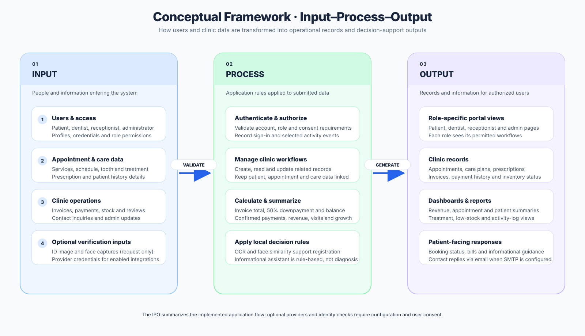
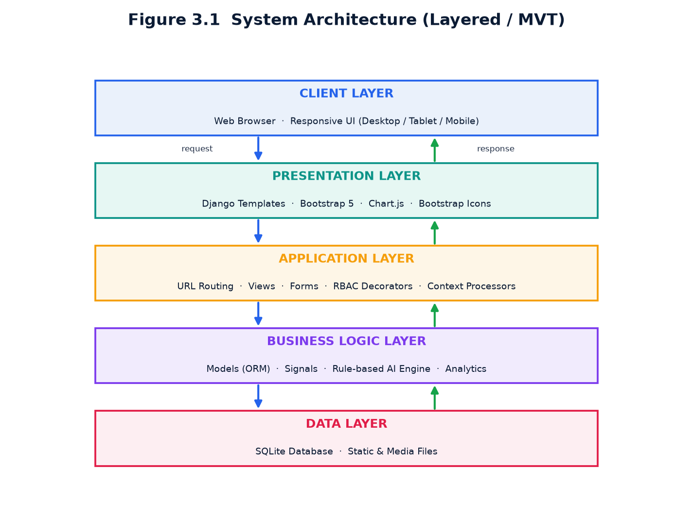
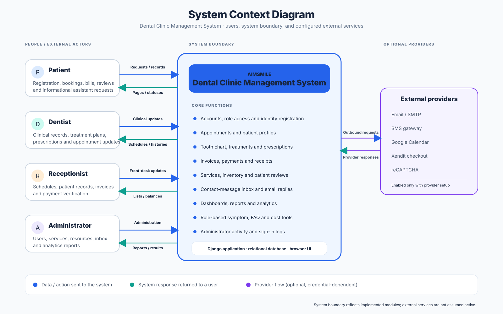
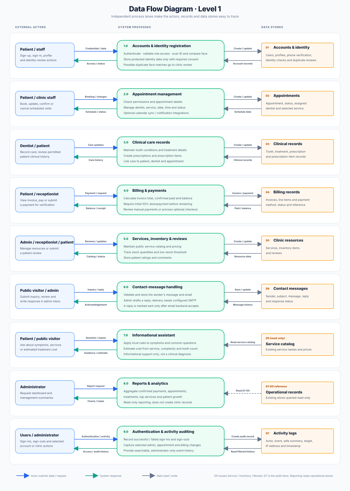
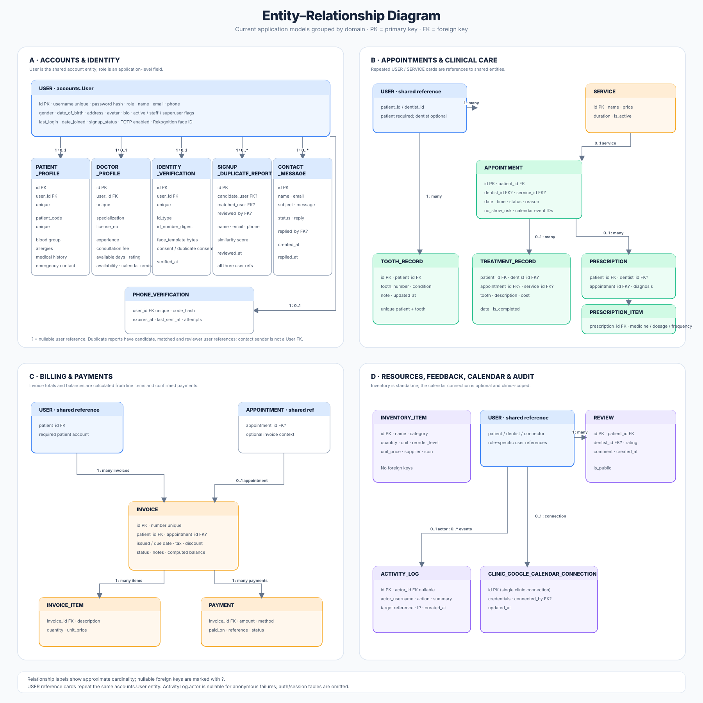

# Dental Clinic Management System

**Academic Project Documentation**  
Batangas State University - Lipa Campus  
College of Informatics and Computing Sciences  
IT 313: Systems Analysis and Design  

**Submitted by:** [Student Name]  
**Student number:** [Student Number]  
**Instructor / adviser:** [Instructor or Adviser]  
**Academic year:** [Academic Year]

> **Draft note:** This report describes the current codebase. Replace the bracketed cover-page fields and obtain approval for the study setting before submission. No clinic interviews, survey results, or formal user-acceptance results were supplied; the problem context and results below are therefore not presented as field research.

<!-- PAGEBREAK -->

## Abstract

The Dental Clinic Management System (DCMS) is a web application developed to organize common administrative and clinical workflows for a dental practice. It provides separate experiences for administrators, dentists, receptionists, and patients. The implemented modules cover user and profile management, consent-based identity verification, service listings, appointment records, tooth records, treatments, prescriptions, invoices, payments, inventory, reviews, contact messages, activity/login logs, and administrative reports. The appointment interface currently uses a custom weekly grid.

The application uses Django's Model-View-Template architecture, a relational data model configurable for MySQL or SQLite, Bootstrap-based templates, and Chart.js visualizations. It includes local rule-based tools for symptom triage, cost estimation, appointment no-show risk, and common chatbot questions. DentaBot does not require an external AI API or key. These tools are informational and are not clinical diagnostic systems.

This report follows the four-chapter format supplied for the project: introduction; related literature, systems, and conceptual framework; methodology and system design; and results and discussion. The latest full verification run executed 81 automated tests, all passing. Django's system check and migration consistency check also passed. This report does not claim user acceptance, clinical validation, performance benchmarking, or production readiness.

## Contents

1. Chapter 1 - Introduction
2. Chapter 2 - Review of Related Literature and Systems
3. Chapter 3 - Methodology
4. Chapter 4 - Results and Discussion
5. References
6. Appendix A - System routes
7. Appendix B - Study and deployment limitations

<!-- PAGEBREAK -->

## Chapter 1 - Introduction

### 1.1 Background of the Study

Oral health services depend on coordinated patient, appointment, clinical, and billing information. The World Health Organization's global oral health report discusses the burden of oral diseases and the health-system challenges involved in improving oral health services [1]. For a clinic, incomplete or dispersed records can make it harder to retrieve appointment history, review treatment information, and summarize operational activity.

The DCMS was developed as an academic software project to demonstrate how a web-based application can bring several clinic workflows into one system. Patients can register and request appointments; authorized staff can manage schedules and records; and administrators can review summarized clinic information. The application also models dental-specific data, including numbered tooth conditions and treatment records.

The project is a software prototype, not a deployment commissioned by a named clinic. The manual-workflow concerns described in this chapter are the project scenario and should be verified with the intended clinic through interviews or observation before being presented as measured local findings.

### 1.2 Problem Statement

The project addresses the design problem of managing clinic information across separate or manual workflows. Such a workflow can make it difficult to keep patient profiles, schedules, clinical notes, prescriptions, invoices, and inventory information connected. It can also limit the ability of staff to see relevant information according to their responsibilities.

The study is guided by these questions:

1. How can a web application organize the clinic's patient, appointment, clinical, billing, and inventory records?
2. How can access to these functions be separated among administrators, dentists, receptionists, and patients?
3. How can appointment and treatment data be summarized for operational review?
4. What functions are implemented in the current DCMS, and what limitations remain before real-world use?

### 1.3 Objectives

#### General objective

To design, implement, and document a role-based web application that demonstrates the management of core dental-clinic workflows.

#### Specific objectives

1. Implement user authentication and dashboards for administrator, dentist, receptionist, and patient roles.
2. Provide records for services, patients, appointments, tooth conditions, and treatments.
3. Support prescriptions, invoices, invoice items, payments, and inventory records.
4. Provide clinic reports, including appointment status, revenue, patient growth, treatment mix, and top services.
5. Implement consent-based identity verification, selected account-security controls, and administrator activity/login logs.
6. Implement local rule-based symptom, cost, and no-show helpers, plus a local FAQ chatbot.
7. Evaluate the implemented application with Django's system check and automated tests, and clearly record untested areas.

### 1.4 Significance of the Study

| Intended beneficiary | Potential value of the prototype |
| --- | --- |
| Clinic administrator | A consolidated view of selected clinic records and summary reports. |
| Receptionist | A common interface for appointment, patient, invoice, and inventory workflows. |
| Dentist | Access to assigned appointment and patient information, with treatment and prescription records. |
| Patient | A self-service account for booking and reviewing the patient's own clinic information. |
| Future students and developers | A Django example that can be studied, tested, and extended. |

These are intended benefits of the implemented features, not measured outcomes from a user study.

### 1.5 Scope and Delimitations

The current application includes:

- role-based accounts and profile information;
- clinic services and appointment records;
- a custom weekly appointment grid;
- tooth records using universal tooth numbers 1-32;
- treatment records and prescriptions with medicine items;
- invoices, invoice items, and payment records;
- inventory items and a low-stock indicator;
- patient reviews and public clinic pages;
- administrator reports, activity/login logs, and Chart.js visualizations;
- consent-based identity-verification and protected duplicate-review workflows; and
- local rule-based symptom, cost, and no-show helpers, plus a local FAQ chatbot.

Optional TOTP two-factor authentication, SMS, reCAPTCHA, email, calendar, and Xendit checkout features require provider configuration and are not guaranteed to be active in every environment; live payment processing was not tested. The current build does not provide native mobile support, multi-branch data separation, imaging-device integration, or a clinically validated diagnostic model. Database settings support MySQL and SQLite; the default is MySQL. A production deployment would require environment-based secrets, restricted hosts, secure hosting, privacy procedures, and operational review.

### 1.6 Definition of Terms

| Term | Meaning in this project |
| --- | --- |
| Role-based access | Restricting view access according to a user's assigned application role. |
| Tooth record | A patient's condition and note associated with a numbered tooth. |
| Treatment record | A record of a treatment associated with a patient and, where provided, a service, dentist, tooth, or appointment. |
| Invoice balance | The invoice total less recorded payments. |
| Rule-based assistant | A local feature that selects outputs using programmed rules; it does not call an external AI model. |
| Top Services | A report chart based on treatment records, with appointment bookings used as a fallback when no treatment records are available. |
| Activity log | A timestamped record of selected sign-in and administrative/clinic actions; it excludes passwords, one-time codes, and submitted form contents. |

## Chapter 2 - Review of Related Literature and Systems

### 2.1 Oral Health and Information Needs

The World Health Organization's Global Oral Health Status Report reviews oral diseases, risk factors, health-system challenges, and opportunities for reform [1]. The report provides context for systems that help organize service information and operational records. It does not establish that the specific clinic scenario in this project has been locally studied; that requires separate field data.

### 2.2 Web-Based Records and Modular Application Design

Django documents a built-in authentication system that supports user accounts and authorization and can be extended for project-specific needs [3]. The DCMS builds on Django with a custom user model and a `role` attribute. Application views use role checks, while some records are further filtered for the signed-in patient or dentist.

The application organizes its functions into Django apps for accounts, clinic workflows, public pages, the assistant, and management. This separation makes the main responsibilities visible in code and allows related models, views, templates, and routes to be maintained together. It does not, by itself, guarantee security or correctness; those qualities still require testing and deployment controls.

### 2.3 Authorization and Privacy

Authentication confirms a user's identity; authorization determines which actions and records that user may access. OWASP recommends explicit authorization checks and least-privilege access [4]. The DCMS applies role decorators and user-specific record filtering as an application-level control. A production review would still need to examine every view, object relationship, and administrative operation.

The Philippine Data Privacy Act of 2012 (Republic Act No. 10173) establishes obligations for processing personal information [2]. The DCMS stores fields such as contact details, allergies, and medical history, so a real clinic deployment would require appropriate lawful processing, notice and consent practices where applicable, data minimization, access controls, retention rules, backups, and incident procedures. This academic prototype is not a certification of legal compliance.

### 2.4 Operational Reporting

Chart.js provides common browser-based chart types for presenting application data [5]. The DCMS uses charts to display selected aggregates such as appointment status, revenue by month, patient growth, treatment distribution, and top services. The charts are summaries of database records; their usefulness depends on the accuracy and completeness of the underlying records.

### 2.5 Comparison of Workflow Approaches

| Approach | Typical characteristics | Consideration for this project |
| --- | --- | --- |
| Paper registers or separate files | Records are maintained in separate artifacts and may require manual cross-reference. | The prototype centralizes selected records in related database models. No local clinic baseline was measured. |
| General-purpose spreadsheets | Flexible for lists and totals, but workflow permissions and linked clinical records must be managed separately. | The DCMS adds authenticated views, role checks, and relationships between clinic records. |
| Current DCMS prototype | Web interface for four roles with appointment, clinical, billing, inventory, reporting, identity-review, and activity-log features. | Demonstrates a unified workflow, but requires usability, security, and clinical review before operational use. |

This comparison describes design differences at a high level. It is not a benchmark against a named commercial product or an empirical comparison.

### 2.6 Synthesis and Project Gap

The reviewed sources establish three design considerations: oral-health systems operate in a sensitive service context [1]; authentication and authorization are distinct controls that must be designed explicitly [3][4]; and charts can present selected operational aggregates [5]. The DCMS brings these concerns together in a dental-oriented prototype with patient, appointment, treatment, billing, inventory, and reporting records.

The project gap is therefore defined as an instructional system-design problem: demonstrating how those workflows can be represented in a single role-based application. Evidence of improved clinic efficiency, patient outcomes, or staff satisfaction has not been collected and is outside the claims of this report.

### 2.7 Conceptual Framework

The study uses an Input-Process-Output (IPO) framework. Inputs represent the people and information handled by the system; processes represent the implemented application workflows; outputs represent the records and summaries made available to authorized users.

| INPUT | PROCESS | OUTPUT |
| --- | --- | --- |
| User roles and profile data; service and appointment details; patient, tooth, treatment, prescription, invoice, payment, inventory, and contact data; consented identity-verification inputs. | Authenticate users; check roles and consent; validate forms; record selected sign-in and activity events; create and retrieve clinic records; calculate invoice values; aggregate reports; apply local helper and FAQ rules. | Role-specific pages; clinic records; reports and administrator activity history; informational helper and chatbot responses. Chat history is not persisted or sent to an external AI provider. |

**Figure 2.1.** Conceptual IPO framework for the DCMS.

The vector diagram separates the system's inputs, implemented processing, and user-facing outputs.

## Chapter 3 - Methodology

### 3.1 Development Approach

The project follows an applied system-development approach. The feature set is organized into modules and implemented incrementally using Django's Model-View-Template pattern. UI refinements and chart changes were iterated during development. A formal clinic interview protocol, participant sample, and dated project schedule were not provided; this report therefore distinguishes current implementation evidence from future user evaluation.

The working sequence is:

1. Define the user roles and clinic workflows to be represented.
2. Model accounts, clinic records, and their relationships.
3. Implement forms, views, URLs, and role checks.
4. Build shared and page-level templates, CSS, and JavaScript.
5. Add dashboards, reports, local informational helpers, and a rule-based FAQ chatbot.
6. Run system checks and automated tests; document unresolved findings.

### 3.2 System Architecture

The browser sends requests to Django routes and views. Views coordinate forms and model operations, then render templates or return data. The ORM persists records in the configured MySQL or SQLite database. Shared CSS and JavaScript support the interface and charts.

**Figure 3.1.** Current application architecture. The database is configurable for MySQL or SQLite.

### 3.3 Functional Requirements

| ID | Functional requirement | Current implementation |
| --- | --- | --- |
| FR-01 | Authenticate users and assign role-appropriate destinations. | Implemented in `accounts`. |
| FR-02 | Restrict protected views by role and, where applicable, by the user's own records or assignments. | Implemented with role decorators and view query filtering. |
| FR-03 | Maintain patient and dentist profiles. | `PatientProfile` and `DoctorProfile` are linked to user accounts. |
| FR-04 | Create, view, update, and manage appointment records and statuses. | Implemented in `clinic`; appointment page displays a custom weekly grid. |
| FR-05 | Store a condition and note for a patient's numbered tooth. | Implemented with `ToothRecord` and universal tooth numbers 1-32. |
| FR-06 | Record treatments and prescriptions, including prescription items. | Implemented with `TreatmentRecord`, `Prescription`, and `PrescriptionItem`. |
| FR-07 | Create invoices, line items, and payment records. | Implemented with calculated totals, paid amount, and balance. |
| FR-08 | Track inventory quantity and identify items at or below reorder level. | Implemented with `InventoryItem.is_low`. |
| FR-09 | Display public service information and accept patient reviews. | Implemented in `pages` and `clinic`. |
| FR-10 | Summarize operational data for administrators. | Implemented using analytics helpers and Chart.js. |
| FR-11 | Provide informational symptom, cost, and no-show helpers, plus a local FAQ chatbot. | All use programmed local rules; none are clinical diagnosis or generative AI. |
| FR-12 | Verify registration identity and support protected duplicate review with consent. | OCR and face-similarity checks support review; they do not prove ID authenticity or liveness. |
| FR-13 | Record sign-in and selected account, appointment, resource, and billing events for administrator review. | Available through the administrator-only Activity Logs page; no passwords, OTPs, or submitted form contents are recorded. |
| FR-14 | Support optional account and clinic integrations. | TOTP, SMS, reCAPTCHA, SMTP email, Google Calendar, and Xendit require environment/provider setup. |

### 3.4 Non-Functional Requirements and Constraints

| Quality area | Design requirement / current status |
| --- | --- |
| Access control | Protected views should enforce authentication and role checks; object-level filtering is needed for patient and dentist records. |
| Privacy | Use fictitious data for demonstrations. Before real patient data is used, define lawful processing, access, retention, backup, and incident procedures. |
| Auditability | Record selected authentication and operational events without persisting credentials, one-time codes, or form payloads. The log page is administrator-only. |
| Usability | Use role-aware navigation and responsive templates so users can reach relevant workflows. No formal usability study has been conducted. |
| Maintainability | Keep app responsibilities separated and use shared templates, assets, and analytics helpers. |
| Compatibility | The system is a browser-based Django application. A formal browser/device compatibility matrix has not been tested. |
| Performance | No load or response-time benchmark has been performed. |
| Deployment security | Current settings are development-oriented (`DEBUG=True`, wildcard `ALLOWED_HOSTS`, and a source-defined secret). These settings must be replaced before deployment. |

### 3.5 Data Flow Diagrams

The context diagram shows the main system boundary and interactions with the patient, dentist, receptionist, and administrator. Administrator activity/login logs are part of the system. External email, SMS, calendar, payment, and CAPTCHA providers are shown as optional integrations that require configuration.

**Figure 3.2.** System context diagram for the DCMS, including user roles and optional external providers.

The level 1 diagram decomposes the system into account and identity, appointment, clinical-care, billing, clinic-resource, contact-message, informational-assistant, reporting, and activity-auditing processes. Each process is placed in its own lane to keep its data flows readable.

**Figure 3.3.** Level 1 data flow for the DCMS, including role-specific inputs and outputs, process decomposition, and application data stores.

Editable vector source: [`11_dfd_level1_clean.svg`](./diagrams/11_dfd_level1_clean.svg).

### 3.6 Entity-Relationship Overview

The diagram includes the custom account, identity-verification, phone-verification, duplicate-review, contact-message, activity-log, appointment, clinical-care, billing, inventory, review, and calendar-connection models. A patient account is represented by a `User` with the patient role and a related profile. One-to-one and foreign-key relationships, including nullable references, are shown. Repeated `User` cards are references to the same account entity, included to keep domain relationships local and readable.

**Figure 3.4.** Entity-relationship diagram based on the current `accounts`, `clinic`, and `pages` model fields and relationships. Django framework authentication, permission, and session tables are omitted.

Editable vector source: [`03_er_diagram.svg`](./diagrams/03_er_diagram.svg).

### 3.7 Selected Data Dictionary

| Entity | Selected attributes and purpose |
| --- | --- |
| `User` | Standard account fields plus role, contact, demographic, address, avatar, bio, signup status, and optional two-factor settings. |
| `PatientProfile` | User link, patient code, blood group, emergency contact, allergies, medical history, registration date. |
| `DoctorProfile` | User link, specialization, license, experience, consultation fee, available days, rating, availability. |
| `IdentityVerification` / `PhoneVerification` | Consented identity-check metadata and protected duplicate-check fields; phone verification hash, expiry and attempt state. |
| `SignupDuplicateReport` | Possible duplicate review with optional candidate, matched-user and reviewer links. |
| `Service` | Name, description, price, duration, icon/image, active flag. |
| `Appointment` | Patient, optional dentist/service, date, time, status, reason, notes, no-show risk. |
| `ToothRecord` | Patient, tooth number, condition, note, update timestamp; unique per patient and tooth. |
| `TreatmentRecord` | Patient, nullable links to dentist/appointment/service, tooth number, description, cost, date, completion flag. |
| `Prescription` / `PrescriptionItem` | Patient and clinician/appointment references, diagnosis and notes; medicine, dosage, frequency, duration, instructions. |
| `Invoice` / `InvoiceItem` / `Payment` | Patient and optional appointment, tax/discount/status; line descriptions and amounts; payment amount, method, date, reference. |
| `InventoryItem` | Name, category, quantity, unit, reorder level, price, supplier, icon. |
| `Review` | Patient, optional dentist, rating, comment, creation date, public flag. |
| `ContactMessage` | Public inquiry, sender/contact fields, administrator reply, response status and timestamps. |
| `ClinicGoogleCalendarConnection` | Optional clinic-scoped calendar credentials and nullable connecting-user reference. |
| `ActivityLog` | Actor snapshot, action, safe summary, optional target reference, remote IP and timestamp. |

### 3.8 Feasibility

- **Technical:** The project is implemented with Python, Django, a configurable MySQL/SQLite database, HTML/CSS/JavaScript, and Chart.js. These components are present in the repository. Production deployment still requires a hardened configuration and a deployment plan.
- **Economic:** The current development stack uses open-source software. Hosting, support, secure backups, and operational maintenance may incur costs; no formal budget was supplied.
- **Operational:** Role-specific pages and workflows are implemented. Clinic staff training and workflow validation have not been conducted.
- **Schedule:** The application exists as a working codebase. No approved historical project schedule was supplied. Any proposed schedule should be adapted to the course requirements and team availability.

### 3.9 Proposed Implementation Plan

The following is an **indicative planning estimate**, not a record of actual project dates.

| Phase | Main activities | Indicative duration |
| --- | --- | --- |
| Requirements and scope | Confirm stakeholders, workflow, privacy needs, and acceptance criteria. | 1 week |
| Analysis and design | Review use cases, data model, architecture, IPO, and DFD. | 1 week |
| Core implementation | Build account, appointment, patient, and clinical modules. | 2-3 weeks |
| Supporting modules | Add billing, inventory, public pages, analytics, and assistant tools. | 2 weeks |
| Integration and verification | Run tests, review access control, correct defects, and conduct user review. | 1-2 weeks |
| Documentation and presentation | Complete diagrams, report, and demonstration materials. | 1 week |

### 3.10 Verification Plan

The verification plan includes Django's system check, automated model/view tests, role-access checks, workflow tests for appointment and billing operations, and manual review of the responsive interface. Separate load, security, clinical, and user-acceptance evaluations are recommended before deployment; they are not represented as completed in this report.

## Chapter 4 - Results and Discussion

### 4.1 Implemented System

The codebase contains the following application areas:

| Module | Implemented result |
| --- | --- |
| Accounts | Sign-up, login/logout, role-based dashboard redirect, profile editing, and password setup flows. |
| Clinic | Appointment, patient, tooth, treatment, prescription, invoice, payment, inventory, and review workflows. |
| Public pages | Home, services, about, and contact pages. |
| Management panel | Administrator dashboard, reports, user/resource management, and searchable, paginated activity/login logs. |
| Assistant | Local rule-based symptom triage, cost estimator, no-show risk helper, and DentaBot FAQ chatbot. |
| Analytics | Revenue, appointment-status, appointment-per-month, treatment distribution, patient growth, and KPI data. |

The appointment interface is a custom weekly grid. FullCalendar is not currently integrated. Top Services uses treatment-record counts and falls back to appointment booking counts when no treatment records exist.

### 4.2 Objective-to-Implementation Review

| Objective | Evidence in current codebase | Discussion |
| --- | --- | --- |
| Role-based accounts and dashboards | Custom user role, role decorators, dashboard views and templates. | Implemented at application level; production access-control review remains necessary. |
| Identity checks and audit history | Consent-based identity workflow; administrator Activity Logs for authentication and selected account/clinic actions. | Implemented with documented privacy and verification limitations; not an independent identity proof or full forensic audit platform. |
| Clinic and patient records | Related Django models and clinic views/forms. | Core record workflows are present; no external clinic data migration was evaluated. |
| Appointment management | Appointment model, status operations, custom weekly grid, and selected change logging. | Implemented; no external calendar service is required for the local schedule. |
| Clinical records and prescriptions | Tooth, treatment, prescription, and prescription-item models/views. | Implemented as structured records, not validated as a clinical record standard. |
| Billing and inventory | Invoice items, payments, balance calculation, inventory quantity, low-stock indicator. | Implemented; no payment gateway or accounting integration is included. |
| Administrative analytics | Reusable aggregation helpers and Chart.js visualizations. | Implemented; report accuracy depends on data quality and volume. |
| Informational assistant | Deterministic local rules in `aiassistant/engine.py`. | Implemented for demonstration only; not diagnostic, clinically validated, or machine-learning based. |

### 4.3 Verification Results

The current full verification run was performed on 24 November 2026 using the project's Windows virtual-environment Python and the SQLite test database.

| Verification | Result | Notes |
| --- | --- | --- |
| `python manage.py check` | Passed | Django reported no issues. |
| `python manage.py makemigrations --check --dry-run` | Passed | No model changes were missing migrations. |
| `python manage.py test` | 81 passed | The full automated suite passed using the SQLite test database. External provider integrations were not exercised as live services. |

These results establish software-level checks for the tested code paths only. No separate performance benchmark, security penetration test, clinical validation, or user-acceptance study was run.

### 4.4 Discussion

The current system demonstrates connected clinic workflows and role-oriented navigation. Its data model supports accounts, consented identity checks, appointments, patient and clinical records, invoices, payments, reviews, contact messages, inventory, and activity logs. The analytics layer derives summaries from these records. Local rule-based helpers and DentaBot return programmed informational responses without an external AI provider.

The results establish feature implementation, not real-world effectiveness. The system has not been evaluated with a named clinic or a representative group of patients and staff. Security controls in application code do not compensate for the current development settings, incomplete operational policies, or the absence of an independent security review. Patient data must not be entered into a public deployment until privacy and security requirements are addressed.

Activity logs provide an administrator-visible record of successful and failed sign-ins, sign-outs, and selected management, appointment, and payment actions. They omit passwords, one-time codes, and submitted form contents. The system should not be represented as recording every read or every change across all modules.

### 4.5 Chapter Summary

The DCMS implements the principal modules specified for this academic prototype. The system check, migration consistency check, and 81 automated tests pass. The current evidence supports a description of implemented features but does not support claims of measured efficiency improvements, user satisfaction, diagnostic accuracy, or production compliance.

## References

[1] World Health Organization. (2022). *Global oral health status report: Towards universal health coverage for oral health by 2030*. https://www.who.int/publications/i/item/9789240061484

[2] Republic of the Philippines. (2012). *Republic Act No. 10173: Data Privacy Act of 2012*. https://lawphil.net/statutes/repacts/ra2012/ra_10173_2012.html

[3] Django Software Foundation. (2025). *Using the Django authentication system* (Django 5.2 documentation). https://docs.djangoproject.com/en/5.2/topics/auth/default/

[4] OWASP Foundation. (n.d.). *Authorization Cheat Sheet*. https://cheatsheetseries.owasp.org/cheatsheets/Authorization_Cheat_Sheet.html

[5] Chart.js Contributors. (n.d.). *Chart.js documentation*. https://www.chartjs.org/docs/latest/

## Appendix A - System Routes

| Path | Purpose |
| --- | --- |
| `/` | Public home page |
| `/services/`, `/about/`, `/contact/` | Public information pages |
| `/accounts/login/`, `/accounts/signup/`, `/accounts/logout/` | Account access |
| `/accounts/profile/` | Profile editing |
| `/app/dentist/`, `/app/reception/`, `/app/me/` | Role-specific dashboards |
| `/app/appointments/` | Appointment schedule and records |
| `/app/patients/`, `/app/treatments/`, `/app/prescriptions/` | Patient and clinical workflows |
| `/app/invoices/`, `/app/inventory/` | Billing and inventory |
| `/ai/symptom-checker/`, `/ai/chatbot/`, `/ai/cost-estimator/` | Informational assistant tools |
| `/manage/`, `/manage/reports/`, `/manage/users/`, `/manage/activity-logs/` | Administrator dashboard, reports, accounts, and activity logs |

## Appendix B - Study and Deployment Limitations

1. Replace all cover-page placeholders with approved academic information.
2. Validate the problem context and requirements with the intended clinic; do not describe assumptions as interview or survey findings.
3. Obtain actual user-acceptance results if required by the course, and report the method, participants, and findings accurately.
4. Keep automated calendar tests aligned with the custom weekly-grid behavior that is currently implemented.
5. Do not deploy with development settings. Configure secrets, hosts, database, HTTPS, static/media handling, email, backups, and access policies.
6. Review the system against applicable privacy requirements before processing real patient information.
7. Treat symptom triage, cost estimates, no-show scores, and chatbot responses as informational outputs only; they are not medical advice or a substitute for clinical judgment.
